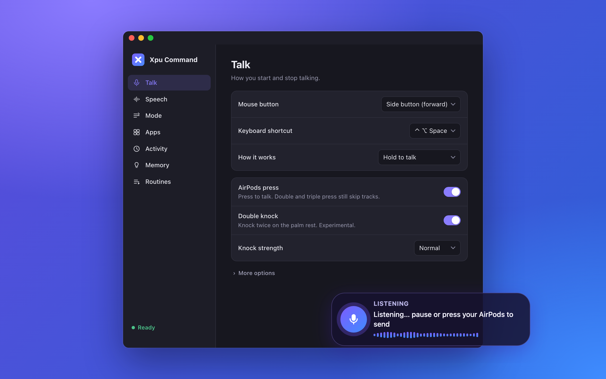
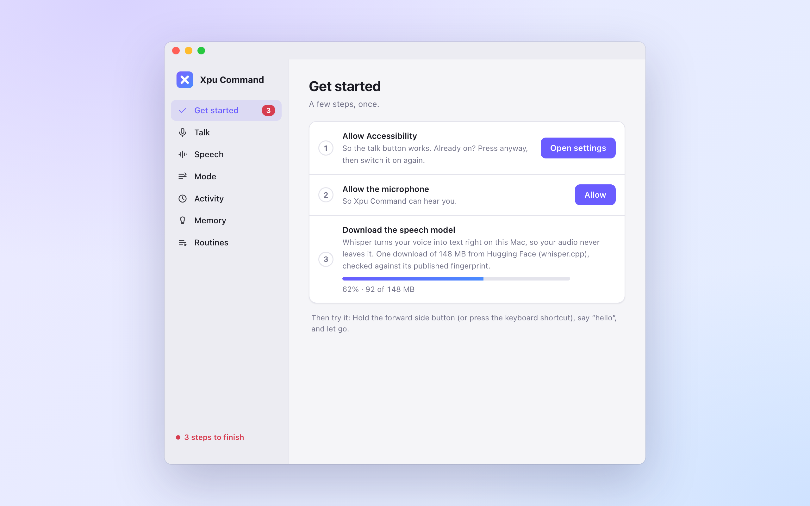
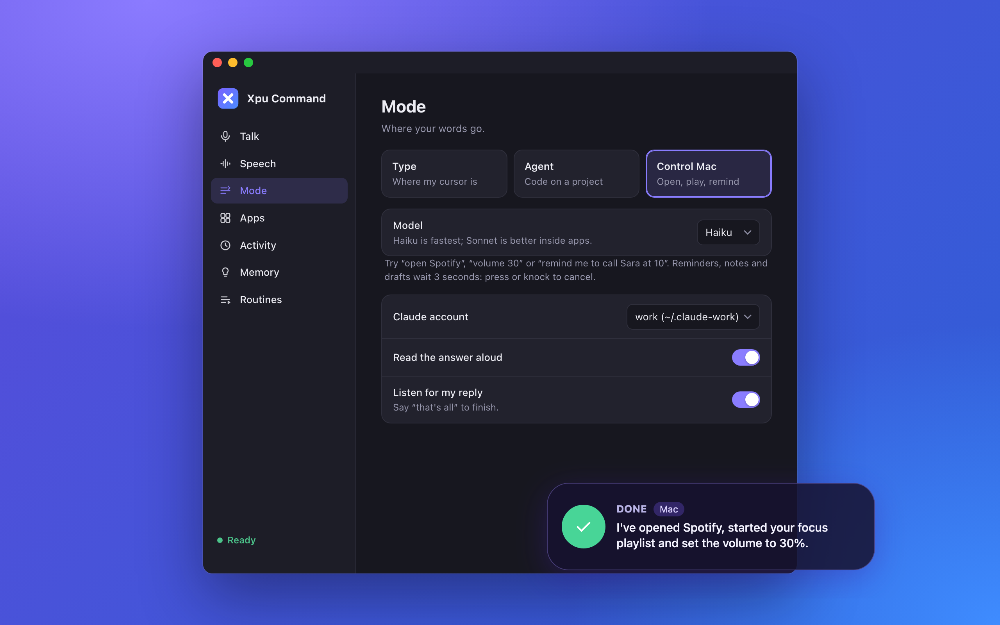
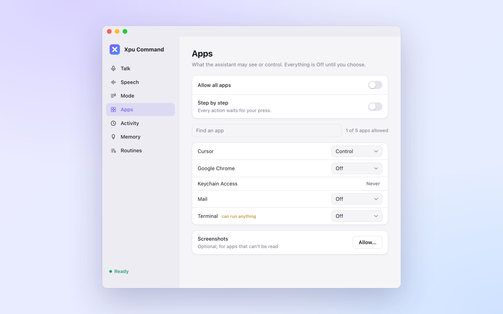
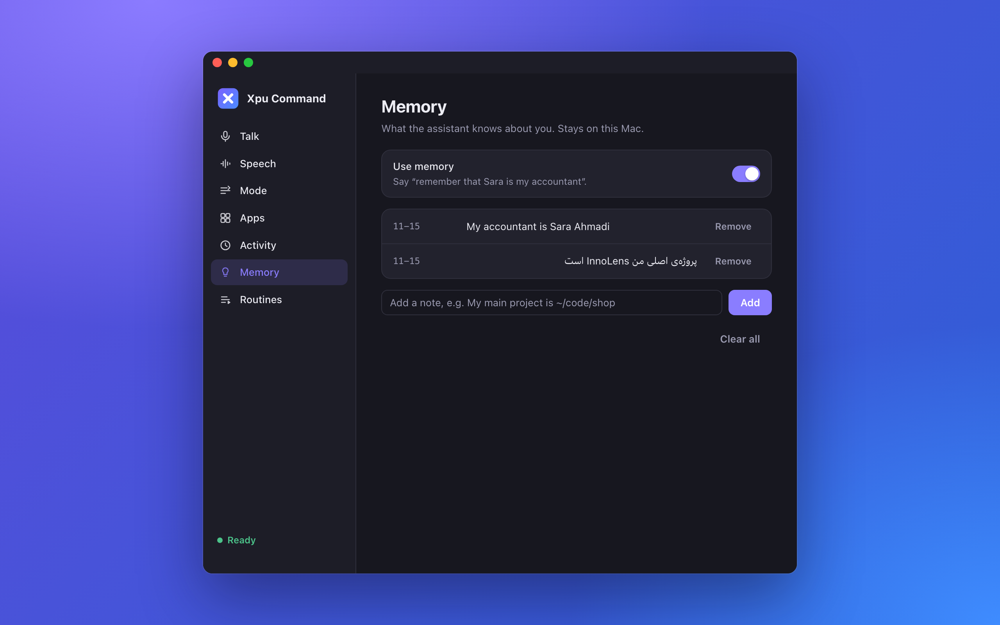
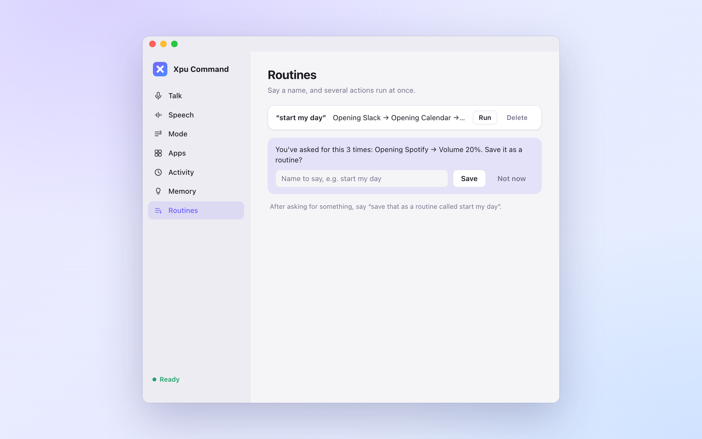
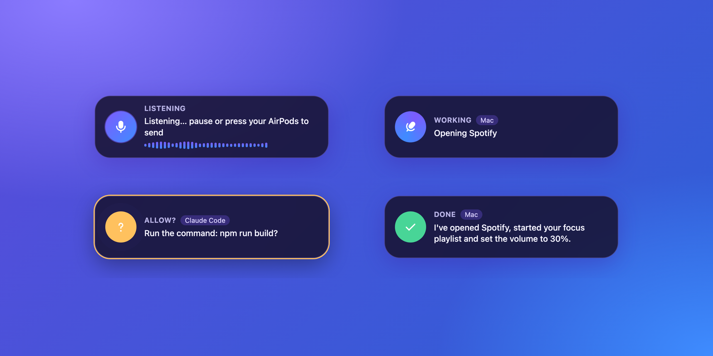

# Xpu Command

**Hold a mouse button, talk to your AI coding agent.** A menu-bar app for macOS and Windows: press and hold
a side button on any mouse, speak, release. Your words are transcribed on your computer and either typed
where your cursor is, or handed to **Claude Code** or **Codex** to work on your project, with live status
and a spoken summary in your headset when it's done.

<p align="center"></p>

<p align="center"><b><a href="https://github.com/XPU-LAB/xpu-command/releases/latest">Download for macOS</a></b> · free and open source · speech stays on your Mac</p>

## Screenshots

| | |
|---|---|
|  |  |
| **Get started.** Three steps, one button each, with a progress bar for the speech model. | **Three modes.** Type where your cursor is, send to Claude Code or Codex, or control your Mac. |
|  |  |
| **App access.** Every app is Off until you choose See, Control or Ask. | **Memory.** "Remember that Sara is my accountant". Stays on your Mac. |
|  |  |
| **Routines.** Say a name and several actions run at once. | **The pill.** Listening, working, asking before a command, done. |

## Download

**[Download Xpu Command for macOS (Apple silicon)](https://github.com/XPU-LAB/xpu-command/releases/latest)**: open the latest release and get the `.dmg` file under *Assets*.

| | |
|---|---|
| Version | 0.5.2 |
| Requires | macOS 12 or later, a Mac with Apple silicon (M1 or newer) |
| File | `Xpu-Command-0.5.2-arm64.dmg` (4.8 MB) |
| SHA-256 | `ac14938015edcea14d540a94c4513c538b9ed0a850abd8ec5fbeff6866c5ce35` |

What's new in each version: [CHANGELOG.md](CHANGELOG.md).

**Install**
1. Open the `.dmg` and drag **Xpu Command** to **Applications**.
2. Open **Xpu Command** from Applications.
3. Allow **Microphone** and **Accessibility** when asked. Xpu Command lives in the menu bar.
4. In **Settings › Speech to text**, download a speech model (148 MB, one time).

**"Apple could not verify Xpu Command is free of malware"**

This build is not notarized by Apple yet, so macOS asks once. To open it:
1. Click **Done** on the message (don't move the app to the Bin).
2. Open **System Settings › Privacy & Security** and scroll down to *"Xpu Command" was blocked to protect your Mac*.
3. Click **Open Anyway**, enter your password, and click **Open Anyway** again.

You only do this once per version. If you prefer Terminal: `xattr -dr com.apple.quarantine "/Applications/Xpu Command.app"`, then open the app normally.

Agent features need [Claude Code](https://docs.anthropic.com/en/docs/claude-code) or [Codex](https://github.com/openai/codex) installed and signed in. To check your download: `shasum -a 256 Xpu-Command-0.5.2-arm64.dmg`.

## How it works

```
mouse button (held) ─► microphone ─► speech-to-text ─► ┬─ Mode A: typed into the focused app (any tool)
  global hook,          in memory       local Whisper   └─ Mode B: Claude Code / Codex on a project folder
  button swallowed      only            or OpenAI          ─► live status pill ─► spoken summary
```

- **Mode A, "type where my cursor is"** works with every tool: a terminal running `claude` or `codex`, Cursor, ChatGPT, anything.
- **Mode B, "send to an agent"** runs the agent headless in a folder you choose, shows what it's doing (*Reading auth.ts*, *Editing login.py*) and reads the result aloud.
  - **Voice approvals (Claude Code, "Edit files; ask me before commands", the default):** every command is asked in the pill and out loud. Answer "yes", "no" or "always", or press to allow; commands that delete, push, publish or run downloaded code need a spoken "yes".
  - **Conversation:** after the answer is read aloud it listens briefly for your reply ("now run the tests"); silence or "that's all" ends it.
  - **Any other agent:** choose *Custom* and pick its program (Aider, Gemini CLI, your own script). It runs in the project folder, reads the request on stdin, gets `XPU_SAFETY` (read_only, edit, ask_commands) and `XPU_RESUME`, and prints plain text or JSON lines (`{"type":"status","text":…}`, `{"type":"session","id":…}`, `{"type":"done","summary":…}`, `{"type":"error","message":…}`). It runs with your permissions: the safety level is passed, not enforced. Shells and interpreters are refused, so speech can't run as code.
  - **Follow-ups continue the same conversation** for 30 minutes (Claude `--resume`, Codex `exec resume`).
  - Say **"stop"** to stop the agent, or **"new task"** to start fresh.
  - **Several Claude accounts?** Pick the profile (`~/.claude`, `~/.claude-work`, …) in Settings; it's passed as `CLAUDE_CONFIG_DIR`.
- **Mode C, "control my Mac"** (macOS): *"open Spotify"*, *"volume 30"*, *"remind me to call the accountant tomorrow at 10"*, *"draft an email to sara@example.com saying I'll be late"*.
  - Claude Code plans with **only the app's own 27 tools** (no shell, no files, no web); the app checks every call, then runs, shows-then-runs, or asks first, by risk.
  - Reminders, events, notes, drafts and quitting apps: shown first, **press or knock within 3 s to cancel**. Shortcuts: **press or knock to allow**. Nothing is ever sent, deleted or bought.
  - **Works inside apps you allow** (Settings › App access: Off / See / Control / Ask each time; Off by default). It reads windows through macOS Accessibility (real buttons and fields, numbered), clicks, types, uses menus and keys; screenshots are a fallback. A glowing outline marks the window it is working on.
  - Every action is in **Settings › Activity**. Debug: `xpu-command --selftest-mac "open calculator"`.
  - **Say "undo that"** (or press Undo in Activity) within 30 minutes to reverse the last request: apps it opened are closed, apps it quit reopen, the reminders, events and notes it made are deleted, and volume, dark mode and music go back.
- **Two triggers:** a mouse button, or a keyboard shortcut (default **⌃⌥Space**) for trackpads. Hold, speak, release.
- **Listening:** after a click (toggle mode) or a double knock it sends when you stop talking (1.5 s of quiet) and cancels if you say nothing. Silence is trimmed before transcription, the stop knock is cut off, and Whisper's phantom phrases ("Thank you.") are dropped. Soft sound cues mark start, send and cancel.
- **Memory:** say "remember that Sara is my accountant" (or add it in Settings › Memory) and the agent knows it from then on; "forget Sara" removes it. Stored on this Mac only (0600), up to 200 short notes, editable and removable, and given to the agent as facts, never as instructions. Turn it off in Settings › Memory.
- **Routines:** several actions under one name. Ask for something, then say "save that as a routine called start my day"; from then on saying "start my day" runs it at once, without waiting for the AI, through the same App access and cancel checks. When you ask for the same actions on different days, Settings › Routines offers to save them. "Undo that" reverses a routine too.
- **Persian (فارسی):** pick Persian in Settings › Speech to text (it switches to a multilingual model; Small is best). Answer with «آره»، «نه» or «همیشه», say «بس کن» to stop and «برگردون» to undo. The agent answers in the language you spoke; macOS has no Persian voice, so those answers are shown, not read aloud.
- **AirPods:** press once to talk (Settings › Talk button › Press AirPods to talk). Double and triple press still skip tracks in Spotify or Music.
- **Double knock (experimental, MacBooks with Apple silicon):** knock twice on the palm rest to start; stop talking or knock again to send. Taps within 1.2 s of typing, clicking or scrolling are ignored. Off by default. Calibrate with `src-tauri/target/debug/xpu-command --selftest-knock [low|medium|high|<g>]`.

## Run it (development)

Requirements: Rust 1.80+, Node 20+, CMake (builds whisper.cpp). For Mode B, the `claude` and/or `codex` CLI installed and signed in.

```bash
npm install
npx tauri dev          # first build compiles whisper.cpp: a few minutes
```

1. **macOS:** grant **Accessibility** when asked (System Settings › Privacy & Security › Accessibility). In development the grant goes to your terminal app. The talk button starts working within two seconds of the grant.
2. Open **Settings** from the menu-bar icon, download the speech model (148 MB, checked against its published SHA-256), pick your button.
3. Hold the button, speak, release.

Tests and checks:

```bash
cd src-tauri && cargo test && cargo clippy --all-targets -- -D warnings   # 126 tests, incl. fake-agent integration tests
cargo audit --deny unsound --deny yanked --ignore RUSTSEC-2024-0429
npm run typecheck
# debug builds only: the pipeline without the GUI
./target/debug/xpu-command --selftest-model base.en
./target/debug/xpu-command --selftest-stt speech.wav
./target/debug/xpu-command --selftest-agent claude /path/to/project "add a test for the parser"
XPU_RESUME=<session id> ./target/debug/xpu-command --selftest-agent claude /path/to/project "what did you change?"
XPU_OVERLAY_DEMO=1 ./target/debug/xpu-command   # cycles the overlay; the frontmost app must not change
```

Release build: see [Releasing](#releasing-macos).

## Releasing (macOS)

```
scripts/release-macos.sh
```
Builds the app and a DMG (`src-tauri/target/release/bundle/dmg/`) and prints its SHA-256. Upload it to a GitHub release.

Without Apple credentials the app is ad-hoc signed, and users see the "Apple could not verify" message once (see [Download](#download)). With an Apple Developer account, set these and run the same script: the app and DMG are signed with your Developer ID and notarized, so they open without any warning.
```
export APPLE_SIGNING_IDENTITY="Developer ID Application: Your Name (TEAMID)"
export APPLE_ID="you@example.com"          # your Apple Account
export APPLE_PASSWORD="xxxx-xxxx-xxxx-xxxx" # an app-specific password from account.apple.com
export APPLE_TEAM_ID="TEAMID"
```

## Layout

| Path | What |
|---|---|
| `src-tauri/src/input/` | Global mouse hook: macOS Quartz event tap, Windows `WH_MOUSE_LL` |
| `src-tauri/src/audio.rs` | Push-to-talk capture (cpal), resampling to 16 kHz |
| `src-tauri/src/stt/` | Local whisper.cpp engine, pinned model catalog and verified download, OpenAI engine |
| `src-tauri/src/sanitize.rs` | Transcript cleaning (no control characters can reach a terminal) and speakable summaries |
| `src-tauri/src/inject.rs` | Mode A: typing into the focused app |
| `src-tauri/src/agents/` | Mode B: the adapter trait, Claude Code and Codex adapters |
| `src-tauri/src/controller.rs` | The talk loop and the overlay |
| `src-tauri/src/commands.rs` | The only commands the settings window may call |
| `src/` | Settings window and overlay (TypeScript, no framework) |

## Status

| | macOS | Windows |
|---|---|---|
| Talk button (hook, swallow, ignore injected clicks) | built, unit-tested | built, unit-tested logic; **not yet run on Windows** |
| Local speech-to-text | verified end to end | needs a Windows build run |
| Mode A typing | built | built |
| Overlay never takes focus | **verified**: frontmost app unchanged during a full overlay cycle | `SW_SHOWNOACTIVATE` + `WS_EX_NOACTIVATE`; not yet run |
| Mode B Claude Code | **verified**: edits a project, shell refused, follow-up resumes the session | not yet run |
| Mode B Codex | flags and event format **verified on codex-cli 0.167.2** (incl. `exec resume` under the same sandbox); a signed-in run not yet done | |
| CI | `.github/workflows/ci.yml`: build, tests, clippy, audits on macOS and Windows | |

Next: selected-text and screen context, a first-run setup guide, auto-update, notarized installers.

Security: see [SECURITY.md](SECURITY.md).
